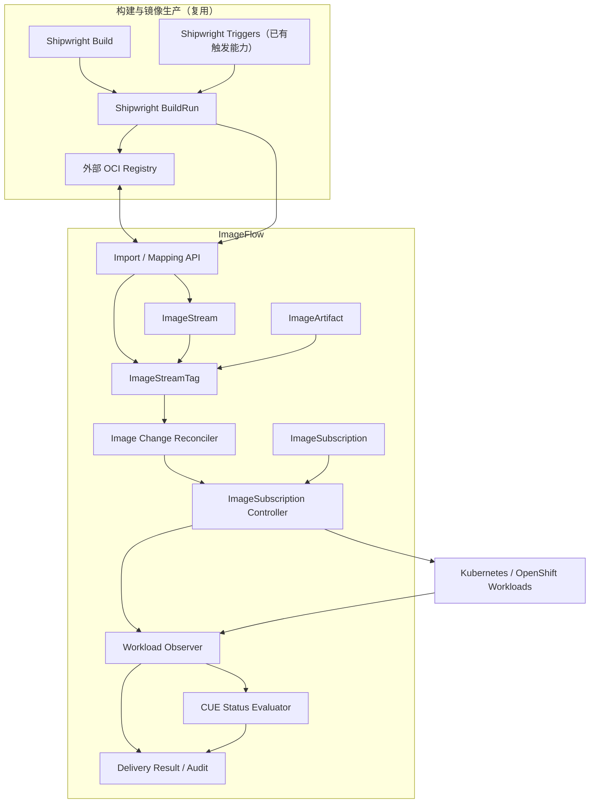
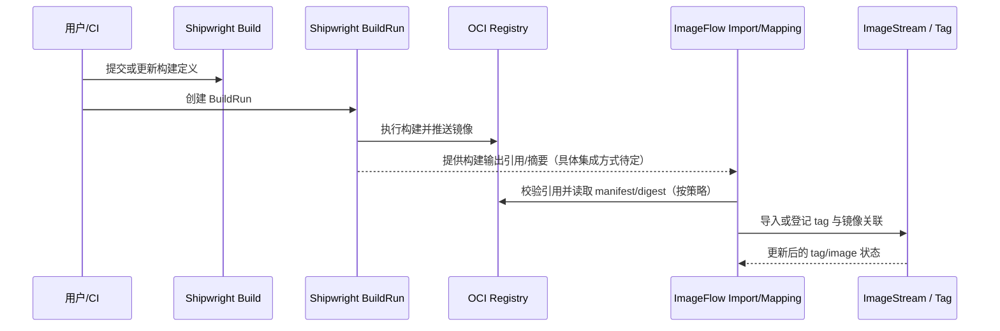
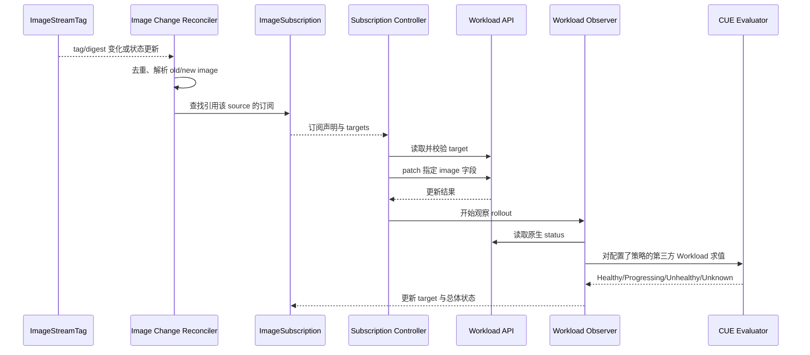
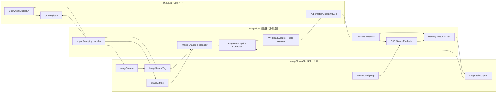

# ImageFlow 项目启动设计文档

> **文档状态：** 项目启动基线 / Draft for implementation  
> **项目名称：** ImageFlow  
> **版本：** v0.1  
> **整理日期：** 2026-10-16  
> **用途：** 作为本地 AI Agent 的项目上下文与后续设计、实现、测试任务输入。  
>
> **决策标记**
> - **[已确认]**：用户已明确接受或决定。
> - **[建议基线]**：当前建议，后续可以通过 ADR 修改。
> - **[待决策]**：启动设计尚未确定，不应由 Agent 擅自假定。
> - **[待源码核实]**：实现前必须针对选定版本的上游源码/API 做核实。

---

## 0. 给 AI Agent 的执行约束

1. 以本文档为项目启动基线；先理解边界，再提出实现计划，不要直接大规模生成代码。
2. 不得将“领域对象”“Kubernetes API Kind”“CRD”“HTTP 操作 API”“内部事件”混为一谈。每个对象必须明确其类别。
3. 不得把 OpenShift 原生能力、Shipwright 已有能力、ImageFlow 计划新增能力混为一谈。
4. 不得把 ImageFlow 描述成 Shipwright Build/BuildRun 的替代品。构建职责继续由 Shipwright 承担。
5. 不得假设 Shipwright Triggers 已经实现“构建输出镜像变化后自动更新 Workload”能力。它的镜像触发能力应根据所用版本核实，常见场景是基础镜像变化触发新构建。
6. 不得假设所有 OpenShift `image.openshift.io/v1` Kind 都必须实现为独立 CRD。尤其 `ImageStreamImport`、`ImageStreamMapping`、`ImageStreamImage` 等需按 API 语义确定为持久化资源、操作型 API 还是查询 API。
7. 第一版原则上尽量不新增 CRD，但 `ImageSubscription` 是当前设计中的核心订阅声明对象；是否实现为 CRD、API 资源或其他持久化声明方式，需在 API 设计阶段形成明确 ADR。不得擅自宣称已决定所有对象的部署形式。
8. 对第三方 Workload，不得仅凭 GVK 或资源名称就声称支持。必须有明确的镜像字段定位规则和状态评估策略。
9. 镜像字段更新成功、Workload rollout 完成、应用健康、业务验证通过是不同阶段，必须分别建模与报告。
10. 发现本文档与选定版本上游源码冲突时，先输出差异表和影响分析，再提议修改，不要静默改写项目目标。
11. 当前尚未决定是否自建镜像 Registry。默认设计应允许复用外部 Registry；不得把 Registry 服务、镜像层存储、分发协议实现自动纳入 v1。
12. 所有未确认事项放入“待决策清单”，不要把建议当作用户已确认决策。

---

# 1. 项目名称与 README 简短说明

## 1.1 项目名称 [已确认]

**ImageFlow**

建议仓库名：`imageflow`。

建议 README 一句话：

> **ImageFlow is a cloud-native image lifecycle and workload image-update control plane. It manages image streams and tags, tracks image changes, and reconciles subscribed workload image fields while observing rollout and health status.**

中文说明：

> ImageFlow 是一个云原生镜像生命周期与 Workload 镜像更新控制平面，管理镜像流与 Tag、追踪镜像变化、按订阅关系更新 Workload 镜像字段，并观测 rollout 与健康状态。它复用 Shipwright 等现有构建能力，不替代镜像构建系统。

项目名不意味着必须采用中心化服务，也不意味着每个逻辑组件都必须独立部署。

## 1.2 命名规则 [已确认]

| 名称 | 含义 | 不应混淆为 |
|---|---|---|
| `ImageFlow` | 项目名称 | 某个单独的 CRD |
| `ImageArtifact` | ImageFlow 的镜像实体领域对象；对齐 OpenShift `image.openshift.io/v1` 的 `Image` 概念 | 镜像字符串或仓库地址 |
| `Image Reference` | 镜像引用值对象，例如 `registry.example.com/team/app:1.2` 或 `registry.example.com/team/app@sha256:...` | `ImageArtifact` 实体 |
| `ImageSubscription` | 镜像来源与一个或多个 Workload 目标镜像字段之间的订阅关系 | OpenShift 注解本身或控制器 |
| `ImageStream` | 镜像流资源，组织 tag 与镜像关联 | Registry 本身 |
| `ImageStreamTag` | 某个 ImageStream 下的 tag 及其当前镜像关联视图 | 单纯的 tag 字符串 |
| `ImageStreamImage` | 通过 ImageStream 与 digest 精确定位镜像的查询/引用概念 | 必然独立持久化的 CRD |
| `Image Change` | 镜像引用或 digest 变化的内部事件/逻辑对象 | 默认新增的 CRD |
| `Image Change Reconciler` | 识别与协调镜像变化的逻辑组件 | 领域实体 |
| `ImageSubscription Controller` | 协调订阅声明并更新目标 Workload 的控制器 | `ImageSubscription` 资源本身 |
| `CUE Status Evaluator` | 执行外部配置的 CUE 状态策略的逻辑组件 | KubeVela Definition 的原生实现 |

---

# 2. 需求边界与项目目标

## 2.1 核心目标

构建一个可在 OpenShift 和标准 Kubernetes 环境中逐步落地的镜像管理与 Workload 镜像更新闭环：

1. 管理镜像流、tag、镜像实体及镜像版本引用。
2. 能够从外部 Registry 导入镜像元数据，并登记镜像推送结果。
3. 识别 tag 指向的镜像或 digest 变化。
4. 通过 `ImageSubscription` 将镜像来源变化映射到一个或多个 Workload 的一个或多个镜像字段。
5. 对内建 Workload 提供稳定的容器名定位方式；对第三方 Workload 提供可配置的字段路径方式。
6. 更新 Workload 后，继续观察原生控制器执行的 rollout。
7. 通过内建观察逻辑或可复用 CUE 策略评估第三方 Workload 的状态。
8. 清楚报告“镜像已应用、rollout 已完成、健康检查通过、业务验证通过”等不同结果。
9. 优先复用 OpenShift、Kubernetes、Shipwright 与外部 Registry 的已有能力。
10. 保持资源 API 与实现模块可逐步扩展，避免第一版过度引入 CRD 或重复实现上游功能。

## 2.2 不在第一版目标内的事项

| 范围 | 第一版边界 |
|---|---|
| 构建引擎 | 不重新实现 Build/BuildRun/BuildStrategy；继续复用 Shipwright |
| Tekton | 不替代 Tekton Pipeline/Task/TaskRun |
| Registry 存储服务 | 默认不自建 Registry；底层自建与否仍待决策 |
| 镜像层 API | 暂不把 `ImageStreamLayers` 纳入核心资源族 |
| 镜像签名 | 暂不把 `ImageSignature` 纳入核心闭环；可后续集成供应链安全能力 |
| 全面替代 OpenShift | 不以复制整个 OpenShift Image API 生态为第一版目标 |
| 自动支持任意 GVK | 不承诺任意第三方 Workload 自动可用；必须配置字段路径与状态策略 |
| 业务验收 | ImageFlow 可观测到 rollout/health；具体业务验收仍由外部测试或交付系统负责 |
| 发布审批与质量门禁 | 不替代 ITSM/发布流程/质量门禁系统 |
| 多集群联邦 | 可作为后续扩展；第一版是否包含联邦控制仍待决策 |

## 2.3 功能需求清单

| ID | 需求 | 优先级 | 验收方向 |
|---|---|---:|---|
| FR-001 | 管理 ImageStream 与 tag 声明 | P0 | 可创建、读取、更新、删除或按定义限制删除 |
| FR-002 | 表达镜像实体 `ImageArtifact` | P0 | 可按 digest 识别镜像并保存必要元数据 |
| FR-003 | 查询 ImageStreamTag 当前镜像 | P0 | 可解析当前镜像引用、digest 与历史状态 |
| FR-004 | 支持 digest 精确寻址 | P0 | 能从 stream + digest 找到对应镜像信息 |
| FR-005 | 外部镜像导入 | P0 | 可读取外部 Registry 的镜像元数据并更新相关状态 |
| FR-006 | 推送结果登记 | P0 | 能把已推送镜像与目标 stream/tag 关联 |
| FR-007 | 检测镜像变化 | P0 | tag/digest 变化能够触发内部协调流程 |
| FR-008 | 声明镜像订阅关系 | P0 | 一份订阅可以有多个目标 Workload |
| FR-009 | 更新内建 Workload 镜像字段 | P0 | 通过 `containerNames[]` 定位容器镜像字段 |
| FR-010 | 更新第三方 Workload 镜像字段 | P0 | 通过 `imageFields[]` 定位一个或多个镜像字段 |
| FR-011 | 观察 rollout | P0 | 区分更新成功、进行中、失败、未知 |
| FR-012 | CUE 可配置状态策略 | P0（设计纳入，实施范围需排期） | ConfigMap 引用的 CUE 策略可评估第三方 Workload |
| FR-013 | 记录更新审计与结果 | P1 | 记录 source、旧镜像、新镜像、目标与结果 |
| FR-014 | ImageTag 兼容/统一查询 | P1 | 明确 API 映射与迁移兼容策略 |
| FR-015 | 镜像签名验证 | P2 | 不作为 v1 阻塞项 |
| FR-016 | Registry 服务自建 | 待决策 | 只有明确需要时才纳入范围 |

## 2.4 非功能需求

- **安全性**：Registry 凭据使用 Kubernetes Secret 或平台认可的凭据机制；避免在状态、事件与日志中泄漏凭据。
- **幂等性**：重复 reconcile 不应造成无意义写入或无限 rollout。
- **可观测性**：结构化日志、指标、事件与可追踪的失败原因。
- **并发安全**：处理资源版本冲突、重试与多控制器竞争。
- **可扩展性**：第三方 Workload 通过字段路径与状态策略扩展，而不是把每个 GVK 都硬编码到主控制器。
- **兼容性**：OpenShift 模式尽量复用原生 ImageStream 语义；标准 Kubernetes 模式不得假定 `image.openshift.io` API 存在。
- **可测试性**：API schema、字段定位、CUE 策略、冲突处理和状态判定都应有单元/集成测试。
- **安全执行 CUE**：限制输入大小、执行时间与可用能力；策略失败不得默认判定成功。
- **可恢复性**：控制器重启后可根据持久化声明和现有状态重新协调，不依赖仅存在内存中的事件。

---

# 3. 架构分析与设计

## 3.1 上游系统的职责边界

| 系统/组件 | 现有职责 | ImageFlow 应如何处理 |
|---|---|---|
| Kubernetes API Server | 持久化 Kubernetes API 对象并提供 watch/list/get/patch 等接口 | 作为资源 API 基础设施 |
| Kubernetes Workload Controllers | 执行 Deployment、StatefulSet、DaemonSet、Job 等原生 rollout/调度行为 | 不重写 rollout；更新模板字段后观察其状态 |
| OpenShift Image API / Image Controller | 管理 ImageStream、tag、镜像导入/引用等 OpenShift 镜像资源语义 | OpenShift 部署可优先复用；独立实现模式需定义兼容范围 |
| OpenShift Image Trigger Controller | 根据触发注解等配置，把镜像变化应用到支持的对象字段 | 作为功能参照和兼容方向，不假设其对任意 GVK 通用 |
| Shipwright Build | 声明构建来源、策略、输出等 | 继续负责构建定义 |
| Shipwright BuildRun | 表示一次构建执行及结果状态 | 作为构建结果来源之一 |
| Shipwright Triggers | 将支持的事件转化为 BuildRun 等构建触发动作；具体版本能力需核实 | 复用已有输入触发能力；不假定它实现输出镜像到 Workload 的更新 |
| 外部 OCI Registry | 存放镜像 manifest、config、layers，并提供 pull/push/manifest 等协议 | v1 默认复用外部 Registry |
| ImageFlow | 管理镜像流抽象、订阅关系、镜像变化到 Workload 字段更新、状态汇总 | 新项目核心职责 |

## 3.2 总体架构



图中是逻辑组件图，不要求每个方框部署成独立服务。控制器可以组合在一个 controller-manager 进程中。

## 3.3 部署模式

### OpenShift 模式

- 优先复用 OpenShift `image.openshift.io/v1` API 与原生 ImageStream 能力。
- ImageFlow 的 `ImageArtifact` 可映射到原生 `Image`，避免在同一集群里无意义地复制镜像实体。
- 对原生 Image Trigger 行为先做版本和支持资源核实，再决定复用、兼容还是由 ImageFlow 接管。
- 避免两个控制器同时修改同一个 Workload 镜像字段。

### 标准 Kubernetes 模式

- 不假定存在 `image.openshift.io/v1`。
- ImageFlow 可实现自己的 ImageStream 风格 API 或内部数据模型，但 API 类型与 CRD 数量必须经过设计决策。
- 镜像元数据通过 Registry API/OCI Distribution API 获取。
- `ImageSubscription` 负责将 source 变化协调到 Workload 字段。
- 通过内建 Workload 适配器与 CUE 状态策略支持第三方 Workload。

## 3.4 镜像变化的识别

推荐以不可变 digest 作为版本变化判断的主要依据，而不是仅比较 tag 字符串：

- `repo:tag` 是可变引用；tag 不变但 digest 变化时也应识别为镜像变化。
- `repo@sha256:...` 是精确引用。
- `ImageStreamTag` 的当前镜像引用/digest 发生变化时，生成内部 `Image Change`。
- 变化事件建议字段：`sourceRef`、`oldImage`、`newImage`、`oldDigest`、`newDigest`、`reason`、`observedAt`。
- `Image Change` 第一版是内部逻辑对象/事件，不默认增加 CRD。
- 必须设计去重、重试、事件丢失恢复与 reconcile 幂等机制。

## 3.5 端到端结果状态

不得把所有阶段合并为单个 `Ready=True`：

1. `ImageResolved`：source 可解析。
2. `ImageApplied`：目标 Workload 的指定字段已更新为期望镜像。
3. `RolloutProgressing`：原生 Workload 控制器仍在执行 rollout。
4. `RolloutSucceeded` / `RolloutFailed` / `RolloutUnknown`：rollout 结果。
5. `HealthSucceeded` / `HealthFailed` / `HealthUnknown`：策略层的健康评估。
6. `BusinessValidation`：如需端到端业务验证，由外部验证/交付系统提供，不等同于 Kubernetes 健康状态。

---

# 4. 概念对照表

| ImageFlow 概念 | OpenShift 对照 | Kubernetes / Shipwright 对照 | 关键边界 |
|---|---|---|---|
| `ImageArtifact` | `image.openshift.io/v1` 的 `Image` | OCI manifest/digest 对应的镜像实体 | 领域实体，不等于镜像字符串 |
| `Image Reference` | `dockerImageReference` 等引用字段 | `registry/repo:tag` 或 `repo@digest` | 值对象，不是 Kind |
| `ImageStream` | `ImageStream` | ImageFlow 自身的镜像流 API/模型（标准 K8s 模式下需设计） | 组织 tag 与镜像关联，不是 Registry |
| `ImageStreamTag` | `ImageStreamTag` | tag 的当前镜像视图 | 主要订阅来源之一 |
| `ImageStreamImage` | `ImageStreamImage` | stream + digest 的精确查询 | 是否独立 Kind 待 API 设计 |
| `ImageTag` | `ImageTag` | tag 定义/历史查询视图 | 与 `ImageStreamTag` 有重叠，需定兼容策略 |
| `ImageStreamImport` | `ImageStreamImport` | 外部镜像导入操作 | 可能是操作型 API，不必是长期持久化对象 |
| `ImageStreamMapping` | `ImageStreamMapping` | 推送结果登记操作 | 可能是操作型 API，不必是长期持久化对象 |
| `ImageSubscription` | 可参考 `image.openshift.io/triggers` 注解表达的订阅行为 | ImageFlow 新增的声明式订阅关系 | 不等于 OpenShift 注解；是否为 CRD需 ADR |
| `Image Change` | ImageStreamTag / Image 变化触发行为 | 内部事件/协调输入 | 不默认是 CRD |
| Image Trigger Controller | OpenShift image trigger 控制器 | ImageFlow Subscription Controller 的参考实现 | 实现组件，不是领域资源 |
| `Build` | 不等同于 ImageStream 资源 | Shipwright `Build` | 构建定义，继续由 Shipwright 负责 |
| `BuildRun` | 不等同于镜像 tag | Shipwright `BuildRun` | 一次构建执行与结果 |
| `Rollout` | DeploymentConfig/Deployment 等控制器状态 | Deployment、StatefulSet 等状态 | ImageFlow 观察，不替代 Workload 控制器 |
| CUE Status Policy | 非 ImageStream 资源 | 参考 KubeVela Definition 的 CUE `healthPolicy` / `customStatus` 思路 | ImageFlow 自己定义 evaluator 合约，不声称直接运行 KubeVela Definition |

---

# 5. ImageFlow v1 资源族清单

> 本清单是用户已接受的**资源族设计基线**。它不表示每个项目都必须成为独立 CRD。持久化资源、操作型 API、查询型 API 与内部模型必须在 API 设计阶段分别确认。

| 资源 / API 名称 | 对应 OpenShift Kind | v1 定位 | 优先级 | 说明 |
|---|---|---|---:|---|
| `ImageStream` | `ImageStream` | 核心资源 | P0 | 管理 tag 声明、镜像流元数据、导入/引用策略 |
| `ImageStreamTag` | `ImageStreamTag` | 核心资源/查询视图 | P0 | 查询某 stream/tag 当前镜像与状态 |
| `ImageArtifact` | `Image` | 核心领域实体/API 映射 | P0 | 镜像 digest 与元数据；OpenShift 模式可映射原生 Image |
| `ImageStreamImage` | `ImageStreamImage` | 查询型 API/引用 | P0 | 通过 stream + digest 精确定位 |
| `ImageStreamImport` | `ImageStreamImport` | 导入 API/操作 | P0 | 导入外部镜像元数据并更新关联状态 |
| `ImageStreamMapping` | `ImageStreamMapping` | 推送结果登记 API/操作 | P0 | 把已推送镜像映射到目标 stream/tag |
| `ImageSubscription` | ImageFlow 新增 | 核心订阅声明 | P0 | 将 source 与 Workload 目标镜像字段关联 |
| `ImageTag` | `ImageTag` | 兼容层/统一查询视图 | P1 | 需要明确是否保留独立 Kind 或合并查询能力 |
| `ImageStreamLayers` | `ImageStreamLayers` | 暂不纳入核心 | P2 | 是否自建 registry/提供层访问能力后再评估 |
| `ImageSignature` | `ImageSignature` | 暂不纳入核心 | P2 | 后续供应链安全能力 |

## 5.1 API 类型分类（待 ADR 明确）

| 类型类别 | 可能对象 | 设计问题 |
|---|---|---|
| 持久化声明资源 | `ImageStream`、`ImageSubscription` | 是否为 CRD？由谁拥有生命周期？ |
| 镜像实体存储/映射 | `ImageArtifact` | OpenShift 模式是否直接映射原生 `Image`？标准 K8s 模式如何存储？ |
| 派生/查询资源 | `ImageStreamTag`、`ImageStreamImage`、`ImageTag` | 是否真的需要可写、持久化 Kind？是否采用 GET/list 子资源或查询 API？ |
| 操作型 API | `ImageStreamImport`、`ImageStreamMapping` | 是 POST 动作、短生命周期资源还是兼容 API？如何返回操作状态？ |
| 内部事件/状态 | `Image Change`、`Delivery Result` | 第一版优先内部事件、状态聚合或审计记录，不默认新增 CRD |
| 可选安全资源 | `ImageSignature` | 后续是否接入 OCI/企业签名与验证系统 |

---

# 6. 组件职责边界

组件是逻辑职责，不意味着每个组件独立部署。

| 组件 | 负责 | 不负责 |
|---|---|---|
| ImageStream API / Repository | 镜像流声明与查询、tag 关系数据 | 不负责构建镜像 |
| ImageArtifact Resolver | 解析引用、digest 与镜像元数据 | 不负责 Workload rollout |
| Image Import Handler | 访问 Registry、读取镜像 manifest/元数据、更新导入结果 | 不负责长期存储镜像 layer（除非后续决定自建 Registry） |
| Image Mapping Handler | 登记已推送镜像与 stream/tag 的关联 | 不负责实际构建或推送镜像 |
| Image Change Reconciler | 发现 source 的镜像引用/digest 变化、去重并触发下游协调 | 不直接承担所有 Workload 类型的字段解析 |
| ImageSubscription Controller | 读取订阅、解析目标、更新目标镜像字段、处理冲突与重试 | 不替代 Deployment/StatefulSet 等原生 rollout 控制器 |
| Built-in Workload Adapter | 对内建 Workload 按容器名定位 `image` 字段 | 不应声称支持未实现/未测试的 GVK |
| Generic Image Field Resolver | 按配置的 `imageFields[]` 解析第三方 Workload 的镜像字段 | 不负责推断任意对象的语义正确性 |
| Workload Observer | 读取原生 status，判断 rollout/状态进展 | 不直接执行发布或改写期望镜像 |
| CUE Status Evaluator | 从 ConfigMap 加载策略，评估第三方 Workload 状态 | 不直接等同于 KubeVela Definition runtime |
| Delivery Result / Audit Sink | 记录 source、旧/新镜像、target、应用结果、rollout/health 状态 | 不替代外部 ITSM 或业务验收平台 |
| Shipwright Build/BuildRun | 构建定义、构建执行与结果 | 不负责 ImageFlow 的订阅和通用 Workload 更新 |
| Shipwright Triggers | 已支持事件的构建触发 | 不应被当作输出镜像更新 Workload 的现成机制 |
| External Registry | 镜像 manifest/config/layer 存储与分发 | 不管理 ImageFlow 的订阅关系 |

---

# 7. ImageSubscription API / CRD 初步设计

## 7.1 核心职责

`ImageSubscription` 声明：

- 从哪里读取镜像：例如 ImageStreamTag，或后续支持的其他 source。
- 哪些 Workload 目标需要更新。
- 每个目标使用内建容器名定位还是通用字段路径定位。
- 如何判断目标 Workload 的 rollout/health 状态。

OpenShift `image.openshift.io/triggers` 注解可作为兼容行为参照，但不是 ImageSubscription 的同义词，也不能据此假定任意 GVK 都可自动更新。

## 7.2 初步字段模型

以下是**概念性 schema 草案**，不是最终可直接 apply 的 CRD。API 版本、schema 校验、默认值、引用命名空间、安全规则和状态条件需要在实现前补齐。

```yaml
apiVersion: imageflow.io/v1alpha1
kind: ImageSubscription
metadata:
  name: app-image-subscription
  namespace: app-team
spec:
  source:
    kind: ImageStreamTag
    name: payments-api:stable
    namespace: image-catalog

  targets:
    - targetRef:
        apiVersion: apps/v1
        kind: Deployment
        name: payments-api
        namespace: app-team
      containerNames:
        - payments-api
      # 内建 Workload：按容器名定位 spec.template 中的 image 字段。
      # 与 imageFields 互斥。

    - targetRef:
        apiVersion: example.io/v1
        kind: WebService
        name: payments-edge
        namespace: app-team
      imageFields:
        - .spec.runtime.containers[name="edge"].image
        - .spec.sidecars[name="proxy"].image
      statusPolicyRef:
        name: webservice-status-policy
        namespace: imageflow-system
        key: policy.cue

status:
  observedGeneration: 1
  conditions:
    - type: SourceResolved
      status: "True"
      reason: Resolved
      message: Source resolved to an immutable image digest.
    - type: ImageApplied
      status: "True"
      reason: Updated
      message: Target image fields match desired image.
    - type: RolloutReady
      status: "Unknown"
      reason: Observing
      message: Waiting for target rollout evaluation.
  targets:
    - targetRef:
        apiVersion: apps/v1
        kind: Deployment
        name: payments-api
        namespace: app-team
      desiredImage: registry.example.com/payments/api@sha256:...
      observedImage: registry.example.com/payments/api@sha256:...
      imageApplied: true
      rolloutStatus: Progressing
      healthStatus: Unknown
      lastTransitionTime: "2026-10-16T00:00:00Z"
```

### 字段设计原则

- `spec.source`：描述镜像来源。应在 API 设计时定义强类型 source reference，不应只靠任意字符串猜测。
- `spec.targets[]`：支持一对多；一个 source 可驱动多个 Workload。
- `targetRef`：必须包含足以定位对象的 `apiVersion`、`kind`、`name`、`namespace`；跨命名空间引用需要权限与安全策略。
- `containerNames[]`：用于内建 Workload 适配器，按容器名定位 image 字段。
- `imageFields[]`：用于第三方 Workload，允许一个目标有多个镜像字段。
- `containerNames[]` 与 `imageFields[]`：**互斥**，不得同时设置；否则应在 schema 或 admission 校验阶段拒绝。
- `statusPolicyRef`：引用 ConfigMap 中的 CUE 状态策略。建议结构至少包含 `name`、`namespace`、`key`。
- `status`：记录观察到的 source、期望镜像、实际字段值、更新结果和 rollout/health 评估。
- 状态应可重建；不能只依赖内存事件。
- 示例中的 `apiVersion`、字段路径语法、状态字段只是草案，需要在正式 API 设计时固定。

## 7.3 `imageFields[]` 的 FieldPath 语法

第三方 Workload 使用 `imageFields[]` 解决“写入哪个字段”的问题；状态判定是独立扩展点。

建议先定义一个受限且可验证的路径语法，例如：
- 以 `.` 开始的 JSON-like 字段路径；
- 支持对象字段；
- 对数组允许基于稳定标识（如 `name`）选择元素；
- 默认不允许任意脚本、任意表达式或可执行代码；
- 每个路径在 reconcile 前必须能验证目标字段存在、类型为字符串且可写；
- 对同一对象中路径重叠、重复或冲突的情况拒绝配置；
- patch 应尽量使用最小字段更新，避免覆盖无关字段。

以上语法是 ImageFlow 建议，并非声称与 OpenShift `fieldPath` 注解语法完全相同。若要求 OpenShift 兼容，需单独制定兼容子集与转换规则。

## 7.4 内建 Workload 与第三方 Workload

| 类型 | 定位方式 | 状态方式 | 要求 |
|---|---|---|---|
| 内建 Kubernetes Workload | `containerNames[]` | 读取原生 status + 内建 evaluator | 按明确支持的 Kind 实现并测试 |
| OpenShift Workload | 按所选资源类型的适配器 | 原生状态 + 版本验证 | 对 DeploymentConfig 等类型逐版本核实 |
| 第三方 Workload | `imageFields[]` | `statusPolicyRef` 引用 CUE | 不能只靠通用字段写入就声称 rollout 可判定 |
| 未配置状态策略的第三方 Workload | 可写入字段（若授权与路径验证通过） | `Unknown` 或明确的有限状态 | 不得默认视为 rollout 成功 |

## 7.5 推荐状态模型

每个 target 至少独立表示：

- `desiredImage`：订阅解析出的期望镜像。
- `observedImage`：当前对象实际字段中的镜像。
- `imageApplied`：实际字段是否等于期望值。
- `rolloutStatus`：`Progressing`、`Succeeded`、`Failed`、`Unknown`。
- `healthStatus`：`Healthy`、`Unhealthy`、`Unknown`。
- `reason` / `message`：稳定的机器可读原因与人类可读说明。
- `observedGeneration`：记录已处理的订阅 spec generation。
- 时间戳与重试信息（按状态设计需要决定）。

不要把 `imageApplied=true` 直接解释为 rollout 成功。对多个 targets，订阅总体状态应根据明确的聚合策略计算，例如 all-targets-required 或 partial success；聚合规则目前仍待决策。

---

# 8. CUE 状态策略设计

## 8.1 已确认的存储选择

**方案 B：ConfigMap 保存可复用 CUE 状态定义。**

`ImageSubscription.spec.targets[].statusPolicyRef` 引用 ConfigMap，建议至少包含：

```yaml
statusPolicyRef:
  name: webservice-status-policy
  namespace: imageflow-system
  key: policy.cue
```

第一版不新增独立 `WorkloadDefinition` CRD。

## 8.2 evaluator 合约建议

输入上下文至少包括：

- `target.metadata`、`target.spec`、`target.status`；
- `desiredImage`；
- `observedImage` / `imageApplied`；
- 订阅与目标的 generation 信息；
- 必要的 rollout 观察上下文。

输出标准化状态至少包括：

- `Healthy`
- `Progressing`
- `Unhealthy`
- `Unknown`

同时输出 `reason` 和 `message`。如果需要区分 rollout 与 health，最好使用两个独立结果，而不是让单个 CUE 结果同时承担所有语义。

## 8.3 安全与失败规则

- ConfigMap 不存在、key 不存在、CUE 编译失败、输入缺字段或评估超时，都不得被视为成功。
- evaluator 失败应返回 `Unknown` 或明确的 `EvaluationFailed` condition。
- 限制 CUE 输入大小、执行时间和允许使用的能力。
- CUE 策略是可执行的判定配置，应考虑 RBAC、变更审计与来源信任。
- 应对同一策略版本的输入建立可重复测试。
- KubeVela Definition 的 `healthPolicy` / `customStatus` 可以作为设计参考，但 ImageFlow 不应声称自己直接使用 KubeVela Definition，除非实际集成。

---

# 9. 关键业务流程

## 9.1 构建结果进入镜像管理



注意：
- Shipwright BuildRun 的实际输出字段取决于 Shipwright 版本和 BuildStrategy；实现前必须查所选版本的 API 与策略行为。
- 不应假定所有策略都提供相同形式的 digest 字段。
- BuildRun 完成不自动意味着 ImageStream 已登记，更不意味着 Workload 已更新。

## 9.2 镜像变化触发 Workload 更新



## 9.3 导入、推送登记和订阅的边界

| 入口 | 输入 | 结果 | 不应隐含的行为 |
|---|---|---|---|
| `ImageStreamImport` | 外部 Registry 引用、目标 stream/tag、凭据引用等 | 镜像元数据与 tag 状态更新 | 不自动构建镜像 |
| `ImageStreamMapping` | 已推送镜像的引用/digest、目标 stream/tag | 登记镜像与 tag 的关系 | 不负责执行 push |
| `ImageSubscription` | source + targets + 定位/状态策略 | 持续协调目标镜像字段 | 不执行镜像构建 |
| Image Change | source 的 old/new 引用或 digest | 触发相关订阅 reconcile | 不直接等于发布成功 |
| Workload Observer | 当前对象状态 | rollout/health 结果 | 不替代业务验收 |

## 9.4 幂等与冲突处理

- 目标字段已经等于期望镜像时，不应重复 patch。
- 同一 source 连续发生相同 digest 的重复事件时，应去重。
- Workload 被删除时，按定义报告 `TargetNotFound`，不要无限重试且不报告。
- target 字段路径无效、字段类型不符、容器名不存在时，应报告明确的失败原因。
- RBAC 不允许读/写目标对象时，报告 `Forbidden`，不得静默跳过。
- 发生资源版本冲突时，重新读取对象、重新校验目标字段并重试。
- 多个订阅同时修改同一字段时，需要明确冲突策略；建议初版检测冲突并报告，不要默默采用“最后写入者获胜”。
- 镜像更新成功后，应记录实际写入的引用，并继续观察 rollout。
- 若 tag 再次变化，应明确是否允许取消/覆盖正在进行的 rollout；默认行为仍待决策。

---

# 10. 核心组件结构建议

建议采用 Go Operator / Controller 架构。具体目录可以随仓库工具链调整，但应保持 API、控制器、解析器与策略评估隔离。

```text
imageflow/
├── README.md
├── go.mod
├── api/
│   └── v1alpha1/
│       ├── imagestream_types.go
│       ├── imagestreamtag_types.go
│       ├── imageartifact_types.go
│       ├── imagesubscription_types.go
│       └── groupversion_info.go
├── config/
│   ├── crd/
│   ├── rbac/
│   ├── manager/
│   └── samples/
├── internal/
│   ├── image/
│   │   ├── reference.go
│   │   ├── digest.go
│   │   ├── resolver.go
│   │   └── metadata.go
│   ├── imagestream/
│   │   ├── repository.go
│   │   ├── tag_resolver.go
│   │   ├── import_handler.go
│   │   └── mapping_handler.go
│   ├── subscription/
│   │   ├── source.go
│   │   ├── target.go
│   │   ├── fieldpath.go
│   │   └── validation.go
│   ├── workload/
│   │   ├── adapter.go
│   │   ├── builtin/
│   │   ├── generic/
│   │   ├── patch.go
│   │   └── observer.go
│   ├── policy/
│   │   ├── cue_loader.go
│   │   ├── cue_evaluator.go
│   │   └── result.go
│   ├── change/
│   │   ├── detector.go
│   │   ├── event.go
│   │   └── dedupe.go
│   ├── delivery/
│   │   ├── result.go
│   │   └── audit.go
│   └── registry/
│       ├── client.go
│       └── credentials.go
├── controllers/
│   ├── imagestream_controller.go
│   ├── imagesubscription_controller.go
│   └── import_mapping_controller.go
├── docs/
│   ├── architecture.md
│   ├── api-design.md
│   ├── decisions/
│   └── references.md
└── test/
    ├── unit/
    ├── integration/
    └── e2e/
```

以上是候选目录，不是必须逐项建立的包。特别是 `ImageStream` 是否自建 API、是否直接使用 OpenShift API，会影响 `api/v1alpha1` 与 repository 的实际内容；在 ADR 决定前，不应一次性生成所有文件。

---

# 11. 控制器与 API 对象泳道图



**读图约定：**
- 箭头表示逻辑依赖或数据流，不一定代表同步调用。
- `Image Change` 与 `Delivery Result` 是逻辑对象，第一版不默认新增 CRD。
- Import/Mapping Handler 可作为 API handler 或 controller 的内部组件，不必独立部署。
- `ImageSubscription` 到 `Workload` 的写入必须经过授权、字段校验与幂等 patch。
- 需要避免 OpenShift 原生 Image Trigger Controller 与 ImageFlow 同时管理相同字段。

---

# 12. 关键 API / CRD 对象增补设计

## 12.1 ImageStream

初步职责：
- 保存镜像流元数据。
- 保存 tag 声明与来源信息。
- 作为 ImageStreamTag 的归属上下文。
- 记录导入策略、引用策略等必要配置。
- 为 tag 变化提供可观察状态。

待明确：
- 标准 Kubernetes 模式是否将它实现为 CRD。
- `spec.tags[]` 与 tag 资源独立建模之间如何取舍。
- 是否保存完整历史，历史条数/保留策略是什么。
- 是否允许同一个 tag 指向 tag、digest 或外部镜像源。
- 删除 stream 时如何处理订阅和历史数据。

## 12.2 ImageArtifact

建议概念字段：
- `digest`：不可变镜像标识，作为主要身份依据。
- `dockerImageReference` 或标准化 `imageReference`：镜像引用。
- `metadata`：必要的 manifest/config 元数据。
- `created` / `architecture` / `os` 等：根据上游 API 与使用场景选择。
- `signatures`：v1 不要求内嵌或完整支持。

注意：`ImageArtifact` 是领域命名；OpenShift 模式可映射原生 `Image`，不应在同一集群里无条件复制一份重复事实。

## 12.3 ImageStreamTag

建议职责：
- 标识 `stream + tag`。
- 可解析当前镜像实体及 digest。
- 记录导入/解析状态与必要的历史。
- 为 ImageSubscription 提供稳定 source reference。

需要避免：
- 把 tag 名称直接当作不可变版本。
- 把查询视图误设计成必须可独立写入的持久化 CRD。
- tag 更新与 ImageArtifact 元数据不一致。

## 12.4 ImageStreamImage

建议语义：
- 用 stream 与 digest 精确定位镜像。
- 为回滚、审计、固定版本部署提供寻址能力。
- 初步考虑作为查询 API 或引用视图，而非独立持久化对象。

## 12.5 ImageStreamImport

输入概念：
- 外部镜像引用。
- 目标 stream/tag。
- 可选凭据 Secret 引用。
- 可选导入策略/平台选择/验证选项（最终字段待设计）。

输出概念：
- 解析后的镜像引用与 digest。
- 导入成功/失败状态。
- 更新后的 ImageArtifact 与 ImageStreamTag 关联。
- 可诊断的错误原因。

安全约束：
- 凭据不得放入明文 spec、status 或日志。
- 需要限制可访问的 registry/网络目标，避免 SSRF 或未授权内网访问。
- 明确是否允许不可信 Registry 与 tag 覆盖。
- 操作失败需可重试、可审计。

## 12.6 ImageStreamMapping

输入概念：
- 目标 ImageStream/tag。
- 已推送镜像引用与 digest。
- 必要的镜像元数据或可从 Registry 获取的引用。
- 调用身份/授权上下文。

输出概念：
- 已登记的镜像实体。
- tag 与镜像关联结果。
- 成功/失败原因。

边界：
- 该操作登记推送结果，不执行构建或 push。
- 需明确允许的调用主体与写权限。
- 不应无条件信任调用方给出的 digest/元数据；必要时从 Registry 校验。

## 12.7 ImageTag

目前作为兼容层或统一 tag 查询视图，尚未决定独立 Kind。
API 设计必须比较：
- OpenShift `ImageTag` 的字段/行为；
- `ImageStream.spec.tags[]` 的声明能力；
- `ImageStreamTag` 的查询/状态能力；
- 客户端兼容需求；
- 对象数量、watch 成本与维护复杂度。

如果它没有独立生命周期或不可替代的兼容价值，应考虑以查询 API/内部结构提供，而不是增加一份重复持久化资源。

## 12.8 ImageSubscription

核心字段已经在第 7 节给出草案。还需设计：
- SourceRef 的强类型和命名空间语义。
- target 跨命名空间授权策略。
- `containerNames[]` 与 `imageFields[]` 的互斥验证。
- 镜像 tag 与 digest 固定策略。
- 冲突策略：多个订阅修改同一目标字段。
- 重试/backoff 与状态条件。
- 多目标聚合策略：全成功、部分成功、失败时如何计算总体状态。
- 暂停/删除/回滚行为。
- 目标对象删除或字段路径失效后的处理。
- `statusPolicyRef` 的 ConfigMap 读取权限与策略版本记录。

## 12.9 Delivery Result（第一版不默认做 CRD）

建议内部结果结构至少包括：

```yaml
sourceRef: image-catalog/payments-api:stable
oldImage: registry.example.com/payments/api@sha256:old...
newImage: registry.example.com/payments/api@sha256:new...
targetRef:
  apiVersion: apps/v1
  kind: Deployment
  namespace: app-team
  name: payments-api
imageApplied: true
rolloutResult: Progressing
healthResult: Unknown
reason: WaitingForRollout
observedAt: "2026-10-16T00:00:00Z"
```

该结构是概念性示例。第一版可以使用结构化日志、事件、订阅 status 或内部审计存储；是否持久化为独立资源需要另行决策。

---

# 13. 阶段规划

## Phase 0：上游源码与 API 核验

目标：冻结第一版范围前验证 OpenShift 与 Shipwright 的真实语义。

工作项：
- 选择目标 OpenShift/Kubernetes、Shipwright 版本。
- 对照 `openshift/api` 中 image/v1 类型定义。
- 阅读 OpenShift image controller 与 image trigger controller。
- 核实 `ImageStreamImport`、`ImageStreamMapping`、`ImageStreamImage`、`ImageTag` 的 API 形态与生命周期。
- 核实 Shipwright Build、BuildRun、BuildStrategy 和 Triggers 的输出字段/事件语义。
- 输出“原生资源 → ImageFlow 处理方式 → 兼容差异”矩阵。
- 建立 ADR：哪些 API 复用、哪些重新实现、哪些是 CRD、哪些是操作/查询 API。

退出条件：不再把上游 Kind 名称直接等同于 ImageFlow 的 CRD 清单；资源类别和目标兼容范围有书面决定。

## Phase 1：API 与最小镜像模型

目标：完成 v1alpha1 API 设计和最小镜像流模型。

工作项：
- 定义 `ImageStream`、`ImageArtifact`、`ImageStreamTag` 的模型边界。
- 明确标准 Kubernetes 与 OpenShift 两种模式的 API 关系。
- 明确 `ImageStreamImage`、`ImageStreamImport`、`ImageStreamMapping`、`ImageTag` 的 API 形态。
- 定义 tag 历史与 digest 语义。
- 完成 schema、RBAC、状态条件与单元测试。

退出条件：API 设计通过 review，资源生命周期、引用关系与状态语义清晰。

## Phase 2：导入、登记与变化检测

目标：打通外部 Registry 到镜像流状态的路径。

工作项：
- 实现 Registry resolver/client 与凭据处理。
- 实现 Import handler。
- 实现 Mapping handler。
- 实现 digest 解析、tag 状态更新与历史记录。
- 实现 Image Change 检测、去重、重试与恢复。
- 增加 registry mock/integration tests。

退出条件：导入/登记后能可靠查询当前 tag 与 digest；digest 变化能产生可观测的内部变化。

## Phase 3：ImageSubscription 与内建 Workload 更新

目标：实现从镜像变化到 Kubernetes Workload 镜像字段更新。

工作项：
- 完成 `ImageSubscription` schema 与 controller。
- 实现内建 Workload Adapter。
- 第一批支持的 Workload Kind 必须在 ADR 中明确，不能只靠口头默认。
- 实现按容器名定位镜像字段。
- 实现最小 patch、冲突处理、幂等与重试。
- 实现 ImageApplied 条件与状态事件。
- 测试多个 targets、对象删除、容器不存在、RBAC 错误和并发冲突。

退出条件：source digest 变化后，所有配置的目标字段按策略更新，且不会无意义地反复 patch。

## Phase 4：Rollout Observer 与 CUE 状态策略

目标：分开判断字段更新、rollout 与 health。

工作项：
- 实现内建 Workload 原生状态观察。
- 实现 ConfigMap CUE policy loader/evaluator。
- 定义策略输入/输出 schema 与标准化状态。
- 实现失败策略：缺失、编译错误、超时、未知状态。
- 增加策略权限、审计、大小和执行时间限制。
- 测试 rollout 成功/失败/超时与第三方 Workload 策略。

退出条件：ImageApplied 与 Rollout/Health 结果明确区分；策略失败不会被错误报告为成功。

## Phase 5：Shipwright 集成、审计与兼容

目标：形成可用的构建结果到镜像管理的闭环。

工作项：
- 根据实际 Shipwright 版本定义 BuildRun 输出接入方式。
- 在构建完成后，将镜像引用/digest 传给 ImageFlow 的 Mapping 或 Import 流程。
- 明确是否通过 Event、Webhook、轮询或其他机制集成；不预设未经验证的上游能力。
- 实现 Delivery Result/Audit。
- OpenShift 模式下验证与原生 Image Trigger Controller 的共存/替代策略。
- 增加 e2e 测试与运维文档。

退出条件：构建结果可登记为镜像版本，订阅目标能更新并报告 rollout/health 结果。

## Phase 6：增强能力（按需求排期）

候选：
- `ImageTag` 兼容层与迁移工具。
- 镜像签名/供应链安全。
- ImageStreamLayers 或 registry 相关能力（仅在确认自建/集成需求后）。
- 多集群与联邦镜像同步。
- 更完整的回滚策略与发布门禁集成。
- 与外部 ITSM/交付系统集成。

---

# 14. 关键风险与待决策清单

| ID | 待决策问题 | 推荐的默认方向 | 为什么不能擅自假定 |
|---|---|---|---|
| D-001 | ImageFlow 是否自建 Registry？ | 默认复用外部 OCI Registry | 决定是否需要镜像 layer、push/pull 服务 |
| D-002 | OpenShift 模式是否直接复用原生 ImageStream API？ | 优先复用原生 API | 避免重复控制器和双重事实源 |
| D-003 | 标准 Kubernetes 模式的 ImageStream 是否为 CRD？ | 在 API 设计阶段决定 | 影响安装、升级、存储与兼容性 |
| D-004 | `ImageSubscription` 是否为 CRD？ | 倾向声明式持久化资源 | 用户已确认领域模型，不等于已确认 CRD 形态 |
| D-005 | `ImageStreamImage` 是 Kind、查询 API 还是内部视图？ | 倾向查询 API/引用 | 避免无必要的持久化对象 |
| D-006 | `ImageStreamImport` 是操作型 API 还是短生命周期资源？ | 优先操作型 API 语义 | 需要明确异步状态、幂等和错误返回 |
| D-007 | `ImageStreamMapping` 是操作型 API 还是资源？ | 优先操作型 API 语义 | 它表达登记动作，不一定有独立生命周期 |
| D-008 | `ImageTag` 是否保留独立 Kind？ | 先评估兼容需求 | 与 ImageStreamTag/Stream spec.tags 有重叠 |
| D-009 | 内建 Workload 第一批支持哪些 Kind？ | 通过源码和测试确定 | 不可笼统承诺任意资源支持 |
| D-010 | `imageFields[]` 的精确语法是什么？ | 定义受限、可校验语法 | 不能直接假设等同于 OpenShift fieldPath |
| D-011 | 多订阅竞争同一镜像字段怎么办？ | 检测并报告冲突 | 防止互相覆盖和反复 reconcile |
| D-012 | 多目标部分成功如何聚合？ | 显式定义策略 | 总体 Ready 含义必须可解释 |
| D-013 | 新 tag 变化时如何处理正在进行的 rollout？ | 待决策 | 涉及取消、覆盖与版本顺序 |
| D-014 | 是否保留完整 tag 历史？ | 先实现有限历史/策略化保留 | 存储成本和 API 兼容性需权衡 |
| D-015 | Shipwright 输出如何接入？ | 针对目标版本核实 | 输出字段与策略行为可能不同 |
| D-016 | OpenShift 原生 Image Trigger 与 ImageFlow 如何共存？ | 避免管理同一字段 | 两个控制器可能产生写入竞争 |
| D-017 | 多集群联邦是否属于 v1？ | 暂不默认纳入 | 会显著影响 source、权限与状态模型 |

---

# 15. 验收标准建议

v1 核心闭环至少需要验证以下场景：

1. 创建镜像流与 tag，并能查询当前关联的镜像 digest。
2. 从外部 Registry 导入镜像后，ImageArtifact/Tag 状态一致。
3. 登记一次已推送镜像，能够更新目标 tag 的镜像关联。
4. 同一 tag 的 digest 变化能够触发变化检测。
5. 一条 ImageSubscription 可以配置多个目标。
6. 内建 Workload 按 `containerNames[]` 正确更新指定容器。
7. 第三方 Workload 按 `imageFields[]` 更新多个指定字段。
8. `containerNames[]` 与 `imageFields[]` 同时出现时，配置被拒绝。
9. 无效字段路径、容器名缺失、RBAC Forbidden、target NotFound 都能报告明确原因。
10. 镜像字段已符合期望时不重复 patch。
11. rollout progressing、succeeded、failed、unknown 可分别报告。
12. CUE ConfigMap 缺失、编译失败、超时、未知结果均不视为成功。
13. 多订阅修改同一字段时触发冲突保护。
14. 控制器重启后可重新 reconcile，不丢失最终一致性。
15. OpenShift 模式不会与原生 trigger controller 无意间重复更新相同字段。
16. Shipwright 构建成功但镜像登记失败时，能区分并报告两个阶段的结果。
17. 镜像 tag 仍然相同但 digest 变化时，能够识别真实镜像变化。
18. 凭据不会泄漏到 status、事件、日志或错误消息。

---

# 16. 参考外链文档

> 下列链接用于启动研究。实现前应固定版本并核对目标分支的 API 与行为；不要把某一版本文档自动当作所有版本的保证。

## 16.1 OpenShift Image API 与镜像触发

- OpenShift API 仓库中的 Image v1 类型定义：  
  https://github.com/openshift/api/tree/master/image/v1
- Image API types（`types.go`）：  
  https://github.com/openshift/api/blob/master/image/v1/types.go
- OpenShift Controller Manager：  
  https://github.com/openshift/openshift-controller-manager
- OpenShift Image Trigger 更新文档（4.17）：  
  https://docs.redhat.com/en/documentation/openshift_container_platform/4.17/html/images/triggering-updates-on-imagestream-changes
- OpenShift Image API 文档（4.19）：  
  https://docs.redhat.com/en/documentation/openshift_container_platform/4.19/html-multi/image_apis/imagestreamimage-image-openshift-io-v1
- OpenShift Image API 文档（4.22）：  
  https://docs.redhat.com/en/documentation/openshift_container_platform/4.22/html-single/image_apis/index

## 16.2 Shipwright Build 与 Triggers

- Shipwright Build 文档：  
  https://shipwright.io/docs/build/
- Shipwright BuildRun 文档：  
  https://shipwright.io/docs/build/buildrun/
- Shipwright Build 源码：  
  https://github.com/shipwright-io/build
- Shipwright Triggers 源码：  
  https://github.com/shipwright-io/triggers

核验重点：
- Build/BuildRun/BuildStrategy 的目标版本和输出字段。
- Triggers 对 Image 事件的具体语义。
- 触发能力是否覆盖当前期望的流程；不要将“基础镜像变化触发构建”误认为“输出镜像变化更新 Workload”。

## 16.3 Kubernetes Workload 与 API 机制

- Kubernetes API 概念：  
  https://kubernetes.io/docs/reference/using-api/api-concepts/
- Kubernetes Deployment：  
  https://kubernetes.io/docs/concepts/workloads/controllers/deployment/
- Kubernetes StatefulSet：  
  https://kubernetes.io/docs/concepts/workloads/controllers/statefulset/
- Kubernetes DaemonSet：  
  https://kubernetes.io/docs/concepts/workloads/controllers/daemonset/
- Kubernetes Jobs：  
  https://kubernetes.io/docs/concepts/workloads/controllers/job/

## 16.4 OCI Registry 与镜像引用

- OCI Distribution Specification：  
  https://github.com/opencontainers/distribution-spec
- OCI Image Specification：  
  https://github.com/opencontainers/image-spec

## 16.5 CUE 与 KubeVela 状态策略参考

- KubeVela Definition：  
  https://kubevela.io/docs/platform-engineers/oam/x-definition/
- CUE 官方文档：  
  https://cuelang.org/docs/

参考原则：借鉴 KubeVela `healthPolicy` / `customStatus` 的配置式状态评估思想，但 ImageFlow 的输入输出 schema、安全模型和执行器由本项目定义。

---

# 17. 建议的启动任务（给 AI Agent 的第一批任务）

请按以下顺序执行，不要跳过 API/源码核验直接生成全部代码：

1. **建立上游 API 对照表**：从目标版本 `openshift/api` 提取 Image v1 所有 Kind、spec/status、操作 API 形态、引用关系和控制器归属。
2. **建立 Shipwright 版本对照表**：核对 Build、BuildRun、BuildStrategy、Triggers 的实际字段和触发行为。
3. **输出 ADR-001：项目运行模式**：OpenShift 原生 API 复用模式、标准 Kubernetes 独立 API 模式，以及是否双模式支持。
4. **输出 ADR-002：API Kind / CRD / 操作 API 分类**：逐一决定第一版资源族中哪些是持久化对象，哪些是查询 API，哪些是操作型 API。
5. **输出 ADR-003：ImageSubscription schema**：固定 source、target、`containerNames[]`、`imageFields[]`、`statusPolicyRef`、status conditions 与验证规则。
6. **输出 ADR-004：镜像字段路径语法**：定义 grammar、数组选择、类型校验、重叠路径和 patch 语义。
7. **输出 ADR-005：Rollout 与 CUE 状态模型**：定义标准状态、超时、失败、聚合与安全约束。
8. 只有上述 ADR 通过 review 后，再生成 API 类型、CRD、controller scaffold 和测试。

每个 ADR 必须包括：背景、决策、备选方案、理由、影响、未解决问题。对上游源码没有证据支持的行为要标记“待源码核实”，不能用推测填补。

---

# 18. 启动基线摘要

- **项目名称：** ImageFlow。
- **项目目标：** 镜像流与 tag 管理、镜像变化检测、订阅式 Workload 镜像字段更新、rollout/health 观察。
- **继续复用：** Shipwright Build/BuildRun/BuildStrategy、Shipwright 已有触发能力、Kubernetes 原生 Workload 控制器、外部 OCI Registry。
- **v1 资源族基线：** `ImageStream`、`ImageStreamTag`、`ImageArtifact`、`ImageStreamImage`、`ImageStreamImport`、`ImageStreamMapping`、`ImageSubscription`；`ImageTag` 作为兼容/查询项待定。
- **v1 暂缓：** `ImageStreamLayers`、`ImageSignature`；是否自建 Registry 待决策。
- **订阅目标定位：** 内建 Workload 使用 `containerNames[]`；第三方 Workload 使用 `imageFields[]`；二者互斥。
- **第三方状态策略：** ConfigMap 存储可复用 CUE 定义，`statusPolicyRef` 引用；第一版不新增独立 `WorkloadDefinition` CRD。
- **状态边界：** ImageApplied ≠ RolloutSucceeded ≠ HealthSucceeded ≠ BusinessValidationSucceeded。
- **实现方式：** 先核验上游源码和 API，再用 ADR 冻结资源类型与边界，然后分阶段实现。
